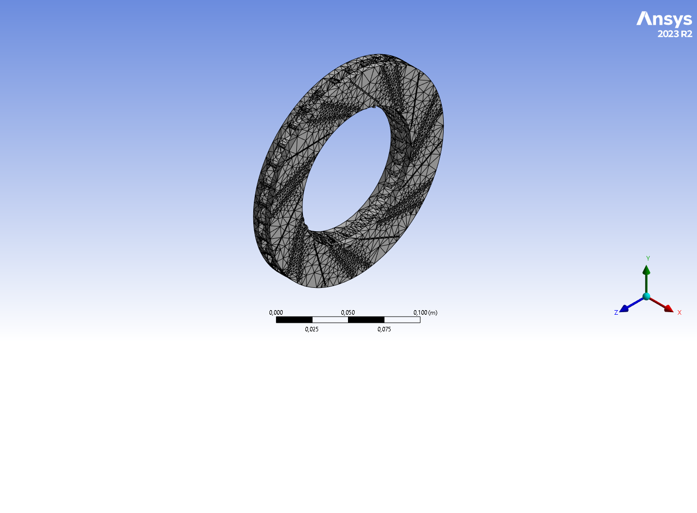
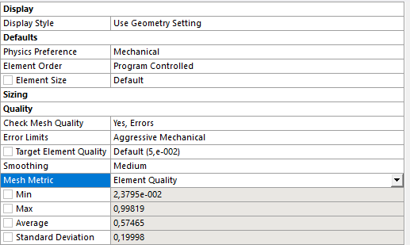
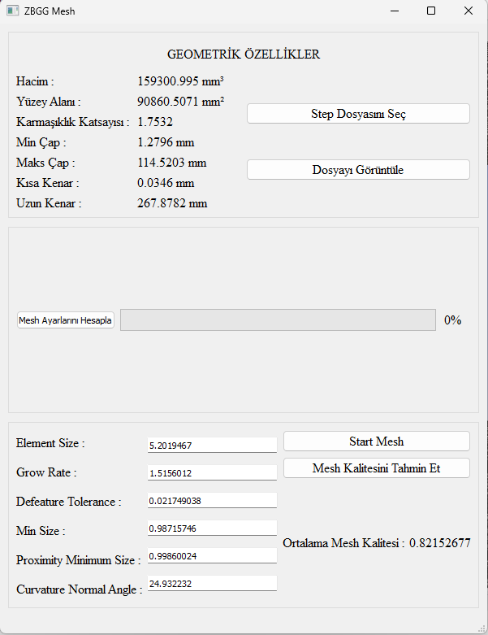
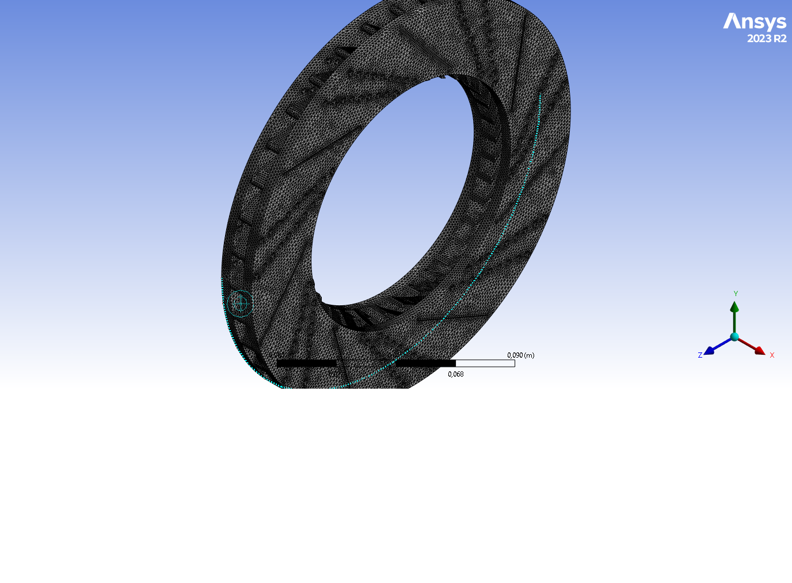

# Ansys ML-Driven Mesh Optimization Macro

This project is an advanced automation tool designed to optimize Ansys Mechanical meshing processes using Machine Learning. By analyzing the geometric properties of STEP files, the application utilizes XGBoost models to predict the optimal mesh settings and forecast mesh quality metrics (Average Element Quality and Standard Deviation) before the meshing process even begins.

The tool features a PyQt5 User Interface and leverages `ansys-mechanical-core` (PyMechanical) to automate the interactions with Ansys Mechanical.

## Visual Demonstration

Here is a comparison of the workflow, showing the raw input, the AI-determined settings, and the refined output.

<table>
  <tr>
    <td align="center">
      
      <br />
      <b>Raw Geometry</b>
    </td>
    <td align="center">
      
      <br />
      <b>Raw Mesh Result</b>
    </td>
  </tr>
</table>

<p align="center">
  
  <br />
  <b>User Interface & Mesh Settings Generation</b>
</p>

<table>
  <tr>
    <td align="center">
      
      <br />
      <b>Refined Geometry</b>
    </td>
    <td align="center">
      
      <br />
      <b>Refined Mesh Result</b>
    </td>
  </tr>
</table>

## Key Features

*   **Geometric Analysis:** Automatically parses STEP files to extract critical features such as Volume, Surface Area, Complexity, Min/Max Radii, and Edge Lengths.
*   **AI-Powered Parameter Optimization:** Uses an XGBoost regression model trained on a custom dataset (`MeshSettings.pkl`) to predict the ideal mesh parameters:
    *   Element Size
    *   Growth Rate
    *   Defeature Tolerance
    *   Capture Curvature Angle
    *   Proximity Minimum Size
*   **Quality Forecasting:** Includes a secondary ML model (`MeshQuality.pkl`) to estimate the resulting **Mesh Average Quality** and **Standard Deviation** based on the chosen settings, allowing for instant feedback without waiting for generation.
*   **Automated Execution:** utilizes PyMechanical to launch Ansys, import geometry, apply the predicted settings, and generate the mesh automatically.
*   **User-Friendly GUI:** A standalone Desktop application built with PyQt5 that simplifies the complex workflow into a few clicks.

## How It Works

1.  **Data Processing:** The tool reads geometric metadata from standard CAD files.
2.  **Prediction:**
    *   The `goemetrikOzellikler` function calculates physical properties.
    *   `meshAyarlarininBelirlenmesi` feeds these properties into the ML model to populate the GUI input fields.
3.  **Simulation:** The `startMeshing` function constructs a Python script dynamically and executes it within the Ansys Mechanical environment via the `ansys.mechanical.core` API.

## Prerequisites

To run this application, you need the following installed:

*   **Python 3.8+**
*   **Ansys Mechanical** (Licensed version compatible with PyMechanical)
*   **Required Python Libraries:**
    *   `PyQt5` (for the GUI)
    *   `ansys-mechanical-core` (for Ansys automation)
    *   `pandas` (for data handling)
    *   `xgboost` (for the ML models)
    *   `scikit-learn` (for metrics and data splitting)
    *   `joblib` (for loading model pipelines)

## Installation & Usage

1.  **Clone the Repository:**
    ```bash
    git clone https://github.com/your-username/Ansys-Mesh-Macro.git
    cd Ansys-Mesh-Macro
    ```

2.  **Model Availability:**
    Ensure the trained models (`MeshSettings.pkl` and `MeshQuality.pkl`) are located in the `Model/` directory. If you need to retrain them, use the scripts provided in the `MachineLearning/` folder.

3.  **Run the Application:**
    Navigate to the `Main` directory and run the app:
    ```bash
    python Main/app.py
    ```

4.  **Workflow:**
    *   Click **"Step Dosyasını Seç"** to load a geometry file.
    *   Click **"Mesh Ayarlarını Hesapla"** to let the AI predict the best parameters.
    *   (Optional) Click **"Mesh Kalitesini Tahmin Et"** to see predicted quality metrics.
    *   Click **"Start Mesh"** to launch Ansys Mechanical and generate the mesh.

## Machine Learning Details

The models were trained on a dataset containing geometric features and their corresponding optimal Ansys mesh configurations.
*   **Training Scripts:** Located in `MachineLearning/`, utilizing `XGBRegressor` and `MultiOutputRegressor`.
*   **Data Manipulation:** See `veriMani.ipynb` for the data cleaning, feature engineering, and visualization process used to create the training datasets.