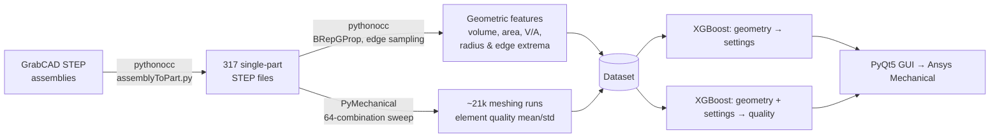
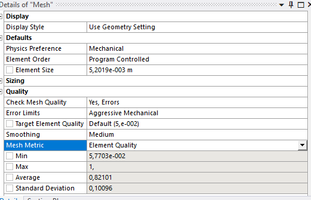

# Ansys ML-Driven Mesh Settings Macro

Predicts Ansys Mechanical global mesh settings from a part's STEP geometry, forecasts the resulting mesh quality before meshing, and runs the mesh through PyMechanical, all from a small desktop GUI.

This is the code behind my B.Sc. thesis (Mechatronics Engineering, Sakarya University of Applied Sciences, Jan 2025). The interesting parts are the **CAD-to-dataset pipeline** (STEP assemblies → single parts → geometric features → ~21,000 automated Ansys meshing runs) and an **honest look at how far global geometric features can take mesh prediction**.

## Pipeline



1. **Assembly splitting** – `assemblyToPart/assemblyToPart.py` reads STEP assemblies with pythonocc (OpenCASCADE) and writes every solid as its own STEP file.
2. **Feature extraction** – volume, surface area, volume/area complexity, min/max radius and shortest/longest edge are computed from the B-Rep.
3. **Parameter sweep** – each part is meshed in Ansys Mechanical with 2⁶ = 64 combinations of element size, growth rate, defeature tolerance, curvature min size, curvature normal angle and proximity min size. Element quality mean and standard deviation are logged for every run (`csvFiles/lastDataSet.csv`).
4. **Models** – two XGBoost regressors: one maps geometry to the best-scoring settings, the other forecasts quality for any geometry + settings pair.
5. **GUI** – `Main/app.py` loads a STEP file, fills in predicted settings, shows the quality forecast and launches the mesh in Ansys via PyMechanical.

## Visual demonstration

<table>
  <tr>
    <td align="center"><br/><b>Raw geometry</b></td>
    <td align="center"><br/><b>Default mesh</b></td>
  </tr>
</table>

<p align="center"><br/><b>GUI with predicted settings</b></p>

<table>
  <tr>
    <td align="center"><br/><b>Refined geometry</b></td>
    <td align="center"><br/><b>Mesh with predicted settings</b></td>
  </tr>
</table>

## Results

All numbers are 5-fold cross-validation with **folds split by part**, so every score is on parts the model never saw. Reproduce with the scripts in `MachineLearning/`.

**Quality forecast** (geometry + settings → quality), trained on the full sweep, 21,155 runs over 317 parts:

| Target | R² | MAE | MAE of mean-predictor baseline |
| --- | --- | --- | --- |
| Element quality, mean | 0.23 ± 0.19 | 0.036 | 0.043 |
| Element quality, std | 0.29 ± 0.12 | 0.020 | 0.024 |

**Settings prediction** (geometry → best settings), 317 parts: mean R² 0.20. Proximity min size (0.56) and curvature min size (0.39) are learnable; curvature normal angle is not (R² below zero).

### A correction to the thesis numbers

The thesis reported per-target R² of 0.65–0.96 for the settings model. When I revisited the code I found that the training data was augmented with noise *before* the train/test split. With an absolute noise of 0.01 on features measured in thousands to millions (volume in mm³, area in mm²), the augmented rows are effectively copies, so the test set contained near-duplicates of training rows.

`MachineLearning/evaluate_leakage.py` scores the same model both ways:

| Protocol | Mean R² |
| --- | --- |
| Augment, then split (thesis) | 0.83 |
| Split by part, augment training folds only | 0.20 |

The training scripts now split first and augment only the training folds.

### What this tells me

Seven global numbers (volume, area, edge and radius extrema) do not describe a part well enough to predict how a mesher will behave on it. Two parts with the same volume and bounding edges can have completely different fillets, holes and thin walls. The quality model beats a mean-predictor baseline by about 15–20% in MAE, but the signal is weak.

That conclusion shaped my later work: representing the part by its **topology** (B-Rep face/edge graphs and mesh graphs processed with graph neural networks) instead of a handful of scalars.

## Repository structure

```
Main/app.py                  PyQt5 GUI + PyMechanical automation
assemblyToPart/              STEP assembly splitter and viewer (pythonocc)
MachineLearning/
  common.py                  feature lists, data loading, part-grouped CV
  xgboosMeshSettings.py      train geometry → settings model
  xgboostMeshQuality.py      train geometry + settings → quality model
  evaluate_leakage.py        reproduces the leakage comparison above
csvFiles/
  Veri.csv                   geometric features per part
  lastDataSet.csv            full sweep: every meshing run with its quality
  MachineLearning.csv        best-scoring settings per part
Model/                       trained models used by the GUI (thesis versions)
img/                         screenshots
```

## Installation and usage

Requirements: Python 3.9+, a licensed **Ansys Mechanical** install supported by PyMechanical, and Windows for the GUI workflow.

```bash
git clone https://github.com/ZBGoztas/Ansys_Macro.git
cd Ansys_Macro
conda install -c conda-forge pythonocc-core
pip install -r requirements.txt
python Main/app.py
```

In the GUI: **Step Dosyasını Seç** (select STEP) → **Mesh Ayarlarını Hesapla** (predict settings) → optionally **Mesh Kalitesini Tahmin Et** (forecast quality) → **Start Mesh**.

Retrain the models (no Ansys needed):

```bash
cd MachineLearning
python xgboosMeshSettings.py
python xgboostMeshQuality.py
python evaluate_leakage.py
```

Splitting your own assemblies: `python assemblyToPart/assemblyToPart.py <folder-with-step-assemblies>`.

## Limitations

- 317 parts from public GrabCAD automotive models; parts under 100 mm³ and parts too large to mesh on the available workstation were excluded.
- The sweep covers two values per setting, so "best settings" means best among 64 combinations, not a global optimum.
- Element quality is the only quality metric; no solver-accuracy check was done.
- GUI labels are in Turkish.

## License

MIT
